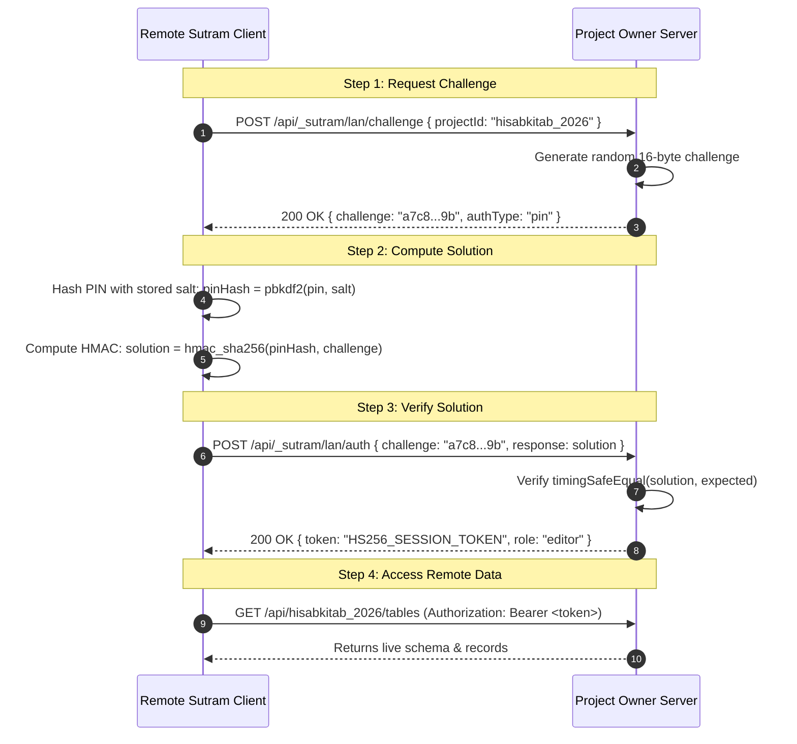

# 📐 SutramLan: Architecture & Network Protocol Specification

## 1. Overview
`sutramLan` establishes a decentralized, zero-configuration local mesh network for Sutram instances running on a shared local area network (LAN / Wi-Fi subnet).

---

## 2. Packet Formats

All communication between nodes on UDP Port `43210` uses UTF-8 encoded JSON datagrams.

### A. Heartbeat Packet (`action: "heartbeat"`)
Emitted periodically (default every 3000ms) by `LanBeacon`:

```json
{
  "app": "sutram-lan",
  "version": "1.0.0",
  "action": "heartbeat",
  "nodeId": "sutram_macbook_7f9b8c",
  "nodeName": "Nast-MacBook",
  "host": "192.168.1.15",
  "port": 3300,
  "os": "darwin",
  "timestamp": 1794501234567,
  "projects": [
    {
      "id": "hisabkitab_2026",
      "name": "HisabKitab Main Store",
      "authType": "pin",
      "authRequired": true,
      "tablesCount": 24,
      "description": "Primary sales & ledger database",
      "updatedAt": 1794500000000
    }
  ]
}
```

### B. Farewell Packet (`action: "bye"`)
Emitted immediately when `lan.stop()` is called (application close or service stop):

```json
{
  "app": "sutram-lan",
  "version": "1.0.0",
  "action": "bye",
  "nodeId": "sutram_macbook_7f9b8c"
}
```

---

## 3. Security & Anti-Replay Handshake Flow

To protect against replay attacks or snooping on local Wi-Fi networks:



---

## 4. Multi-User Concurrency & Transaction Safety

1. **Single-Writer Lock Principle**:
   - The database file remains exclusively on the hosting machine (`Machine A`).
   - Remote machines do not open the SQLite file directly over SMB.
   - All write mutations pass through `sutramEngine` on `Machine A`, ensuring atomic transactions and trigger pipelines execute sequentially and safely.
2. **WebSocket Sync Propagation**:
   - When a remote user updates a cell, the server processes the edit and broadcasts a WebSocket notification to all active peers, instantly keeping all connected screens in sync.
